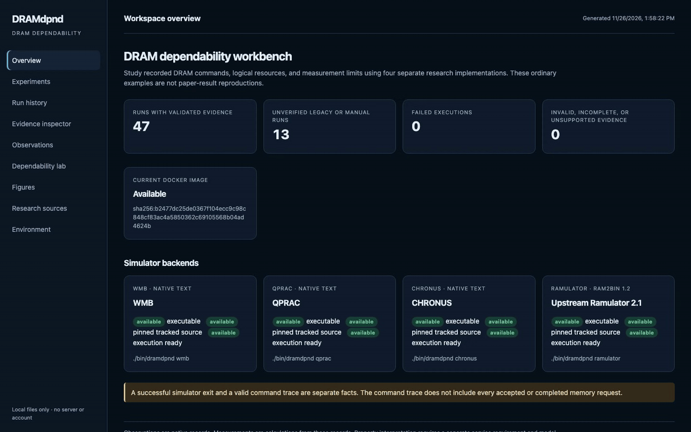
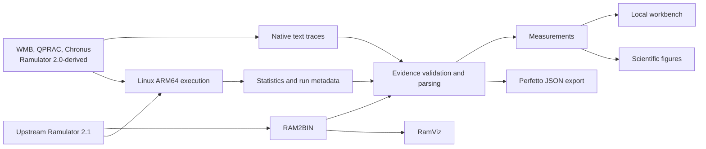

# DRAMdpnd = DRAM dependability platform

I built DRAMdpnd as a teaching and research artifact for studying the reliability and security of DRAM architectures. I use it to inspect what happens inside a simulated memory system, from issued commands and logical bank activity to timing and protection-related observations where the trace supports them.

DRAMdpnd brings together original Ramulator2 research artifacts, a local workbench, trace visualization and reproducible measurements. In the long run, I want to explore whether DRAMdpnd can serve as a generic middleware layer for dynamically integrating and running arbitrary Ramulator2-based research artifacts. For now, I am working with three external Ramulator2-based artifacts as part of my master's seminar on *Dependable Computing* at KIT's **Chair of Dependable Nano Computing (CDNC)**.

## Workbench



Select a run to inspect its configuration, native statistics, command distribution, logical bank activity and measurement definitions. The Dependability laboratory connects these observations to reliability and security questions, and identifies where more evidence is needed.

## Research artifacts

| Paper | Implementation |
| --- | --- |
| *When Mitigations Backfire: Timing Channel Attacks and Defense for PRAC-Based RowHammer Mitigations* (ISCA 2025), WMB | Standalone PRACLeak simulator |
| *QPRAC: Secure and Practical PRAC-based RowHammer Mitigation using Priority Queues* (HPCA 2025) | Performance-analysis simulator |
| *Chronus: Understanding and Securing the Cutting-Edge Industry Solutions to DRAM Read Disturbance* (HPCA 2025) | Original Chronus simulator |
| [Ramulator 2.1](https://github.com/CMU-SAFARI/ramulator2/tree/7bead6cb7c4b03e095c6d4769ae3181a8e0bf6da) | Upstream reference simulator and RamViz |

WMB, QPRAC and Chronus are derived from Ramulator 2.0 and emit native text traces. The separate upstream 2.1 reference uses `BinTraceRecorder` to record RAM2BIN. DRAMdpnd reads both formats without modifying the simulators. The separate TPRAC and QPRAC security-analysis workflows are outside the current integration.

## Trace visualization


RamViz is the upstream Ramulator 2.1 viewer. It opens native RAM2BIN traces and shows command timing, bus activity and reconstructed bank states. The older research artifacts use a different trace format and cannot be opened in RamViz directly.

DRAMdpnd also exports issued-command instants to Perfetto when a run has a verified model clock. The export has been checked; interactive Perfetto import is still unverified. See [visualization](docs/visualization.md) for trace compatibility and the definitions of bus utilization and bank-time statistics.

## Getting started

The four backends have been run on macOS ARM64 using a Linux ARM64 Docker environment. See [environment setup](docs/environment.md) for the pinned sources, build commands and prerequisites. A clean-host installation has not been tested end to end.

```bash
./bin/dramdpnd doctor
./bin/dramdpnd status
./bin/dramdpnd wmb
./bin/dramdpnd runs
./bin/dramdpnd verify RUN_ID
./bin/dramdpnd analyze RUN_ID --summary
./bin/dramdpnd ui
```

Replace `RUN_ID` with the identifier printed by a run. Use `qprac`, `chronus` or `ramulator` in place of `wmb` to select another backend. Each command runs a small ordinary workload and saves its own configuration, statistics, trace and execution metadata under `runs/`.


Use `./bin/dramdpnd figures RUN_ID` to generate SVG, PDF, PNG and CSV outputs with the optional plotting environment. Use `./bin/dramdpnd ramulator ramviz` to open a validated upstream trace or `./bin/dramdpnd perfetto RUN_ID` to export issued-command observations. The default `analyze RUN_ID` output is JSON.

## Architecture



## Measurement scope

I keep observations, measurements and dependability assessments separate. A bank's command share is the percentage of bank-addressed issued commands attributed to that bank. It does not measure how long the bank was active. A valid trace also does not establish a physical reliability or security guarantee.

The included workloads are learning examples rather than reproductions of the papers' results. Issued commands do not cover the full request lifecycle, the observed command span is not total simulation time, and logical resource identifiers do not describe physical die geometry. Property assessments require a service definition, sufficient observation coverage and an appropriate model. Adding support for more research artifacts will require checking those assumptions for each implementation.

The [measurement guide](docs/measurements.md) defines the available quantities. The [exploration guide](docs/exploration.md) contains source-reading exercises for the DRAM state machine, request lifecycle, address mapping and timing. See [run evidence](docs/runs.md), [figures](docs/figures.md), [workbench](docs/workbench.md) and [development](docs/development.md) for implementation details.

## License and attribution

I license my original DRAMdpnd contributions under the [MIT License](LICENSE). The external simulators, research artifacts and their associated material retain their own copyright and licensing terms. [THIRD_PARTY.md](THIRD_PARTY.md) lists the papers, authors, pinned revisions and observed license boundaries.
